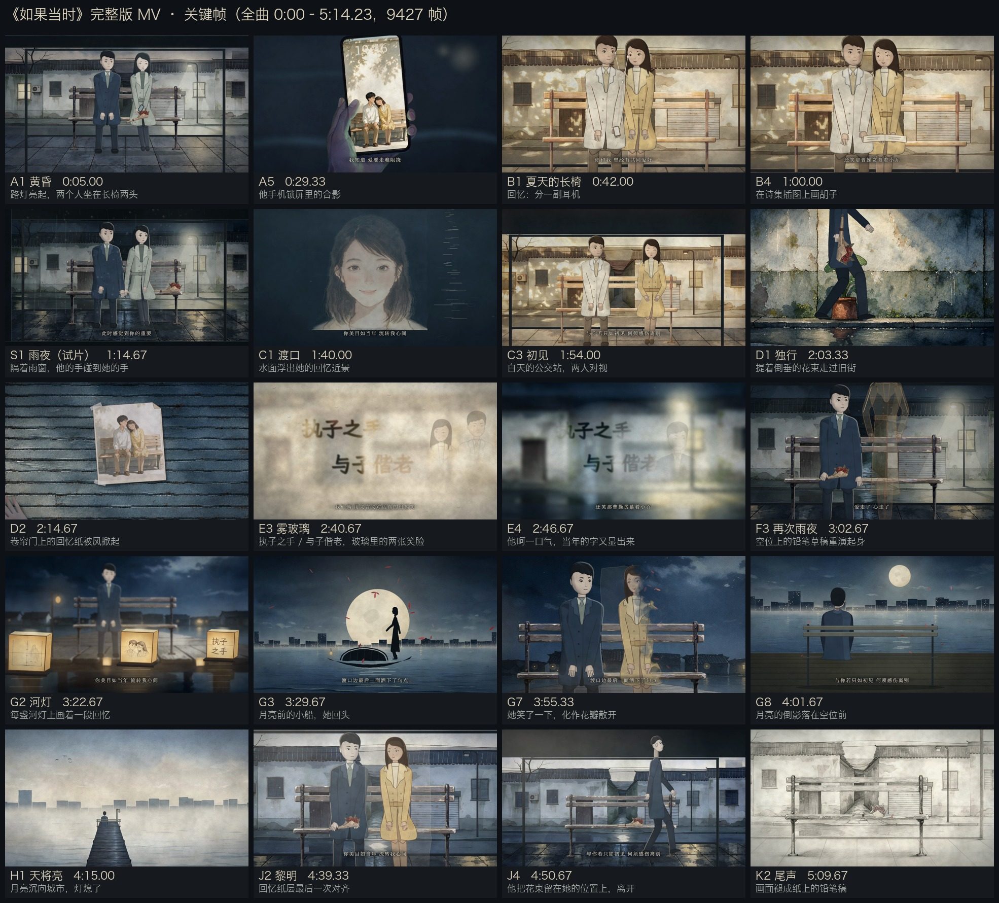

# 《如果当时》动画 MV — 试片与完整版

Remotion + React + TypeScript。人物、动作和所有动态效果由代码绘制：SVG 画角色骨架，Canvas 2D 画雨、水珠、花瓣、涟漪、擦除和「化作花瓣」。
场景背景、长椅和几张插画是用 Seedream（火山方舟图片生成）照着原来的 SVG 场景重绘的水粉画（`public/plates/`），按世界坐标贴回去，和人物、道具严格对齐。纸纹是固定种子生成的静态贴图。音轨是原曲的样本级切片，原速、原调、原编曲。

| | 试片 `RuguoPilot` | 完整版 `RuguoFull` |
|---|---|---|
| 原曲区间 | 01:07.290–01:37.290 | 00:00.000–05:14.233（全曲） |
| 帧数 | 900（30.000 s） | 9427（314.233 s） |
| 成片 | `deliverables/ruguodangshi_pilot_1080p.mp4` | [Releases 页面下载](../../releases)（408 MB，超过 GitHub 单文件上限，不在仓库里） |
| 关键帧联系表 | `deliverables/contact_sheet.jpg` | `deliverables/full_contact_sheet.jpg` |
| 分镜 | `docs/storyboard.md` | `docs/full-storyboard.md` |

两者都是 1920×1080、30 fps、H.264（yuv420p，BT.709）+ AAC 48 kHz。完整版把试片原样嵌在帧 2019–2919（第三幕）。



> 歌曲《如果当时》（词曲：许嵩）的版权归原作者所有。仓库里不包含原曲音频文件；成片中的音轨仅用于展示这部同人动画习作。
制作说明（截取理由、镜头与音乐的对应、设计选择、检查中修正的问题、仍需改进）：`docs/production-notes.md`。

## 环境

- Node.js `^20.19 || ^22.13 || >=24`，npm（依赖版本已写死，并保留 `package-lock.json`）
- ffmpeg / ffprobe ≥ 6（准备音轨、拼接与封装成片；4.x 的 concat 会让分段拼接产生音画漂移，见 `scripts/finalize-full.sh`）
- 渲染时 Remotion 会自动下载 Chrome Headless Shell。离线环境可以指定本机浏览器：
  `REMOTION_BROWSER=/path/to/chrome npm run render`

## 安装与准备音轨

```bash
cd ruguodangshi-pilot
npm ci
npm run prepare-audio   # 从 ../downloads/BV1JA41147Qo/*.m4a 生成试片与全曲 WAV（约 60 MB，不放进仓库）
# 原曲放在别处时：bash scripts/prepare-audio.sh /path/to/如果当时.m4a
```

## 预览

```bash
npm run dev            # Remotion Studio：RuguoPilot / RuguoFull / dev/CharacterSheet
```

## 渲染

```bash
# 试片
npm run render:preview        # 960×540 带音轨测试片
npm run render                # 1080p → deliverables/ruguodangshi_pilot_1080p.mp4

# 完整版
npm run render:full:preview   # 960×540 带音轨测试片 → out/full_preview_960x540.mp4
npm run render:full           # 1080p 分段渲染（out/segs/，可中断续跑）→ 拼接 → 用原曲 WAV 封装
                              # → deliverables/ruguodangshi_full_1080p.mp4
bash scripts/render-full-segments.sh 0 4999      # 也可以只渲一段，在另一台机器上渲其余部分，
bash scripts/render-full-segments.sh 5000 9426   # 把 out/segs/ 合到一起后运行 npm run finalize:full

# 检查
node scripts/stills.mjs out/check 4800,6290,9290 3 0.5 RuguoFull   # 多帧检查联系表
python3 scripts/contact-sheet-full.py deliverables/ruguodangshi_full_1080p.mp4 deliverables/full_contact_sheet.jpg
```

`finalize-full.sh` 会先检查各段首尾相接、总数正好 9427 帧，再拼接；所有段必须用脚本里写死的同一组编码参数。

## Seedream 背景板与插画

生成好的图片已经在 `public/plates/` 里（每张旁边的 `.json` 记着提示词、参考图、模型和生成时间），渲染不需要联网。要重新生成或新增时：

```bash
# 1. API 配置写进 .env（不进仓库）
#    ARK_API_KEY=…
#    ARK_IMAGE_URL=https://ark.cn-beijing.volces.com/api/plan/v3/images/generations
#    ARK_IMAGE_MODEL=doubao-seedream-5.0-pro
# 2. 渲染参考底稿（原来的 SVG 场景、长椅、角色设定页）→ out/ref/
bash scripts/plate-refs.sh
# 3. 生成
node scripts/seedream.mjs --list          # 任务清单（✓ = 已有输出）
node scripts/seedream.mjs alley_night     # 重新生成某一张（旧文件移到 out/plates_archive/）
node scripts/seedream.mjs                 # 生成所有还没有输出的任务
```

- 任务清单在 `scripts/plates.jobs.mjs`。派生的背景板（黄昏、黎明、回忆白天……）以夜景为底稿，保证是同一条街；它们依赖的底稿会先生成。
- 单张图上限约 460 万像素（例如 2816×1636），生成后按 `fit` 缩放到世界坐标的精确尺寸。
- 长椅和近景里的手是在纯绿底上生成的，`scripts/chroma-key.py` 抠成透明 PNG（原图留在 `out/plates_src/`，调抠像参数不用重新生成）；河灯上的小画画在白纸上，`--white` 把白纸转成透明。
- 月亮、月光倒影、雨、灯光、花瓣、河灯和人物仍由代码画在背景板上面，保留原来的动画。

## 改哪里

| 想改的东西 | 文件 |
|---|---|
| 完整版镜头切点（以原曲秒为单位）| `src/full/timeline.ts` |
| 完整版歌词字幕时间 | `src/full/lyrics.ts`（核对记录见 `analysis/full-lyrics-timing.md`） |
| 完整版各幕的镜头 | `src/full/acts/Act1.tsx`（黄昏）… `Act11.tsx`（尾声），镜头表 `src/full/shots.tsx` |
| 试片的截取、切点、字幕 | `src/config/timeline.ts`，镜头在 `src/shots/S1Glass.tsx` … `S5EmptySeat.tsx` |
| 色板 | `src/config/palette.ts` |
| 人物服装与回忆配色 | `src/characters/designs.ts` |
| 人物骨架与比例（正面坐/起身、侧面行走、背面） | `src/characters/front.tsx`（`DIM`、`RISE`、`HEAD_K`）、`walk.tsx`、`back.tsx`、`head.ts` |
| 公交站与旧街（含黄昏/黎明/回忆白天） | 背景板 `src/env/Plate.tsx`（`AlleyPlate`），场景层次 `src/env/BusStop.tsx`；旧的 SVG 街景 `src/env/Alley.tsx` 现在是背景板的参考底稿 |
| 月下河面、栈桥正面的背景板 | `src/env/Waterside.tsx`（`RiverBackdrop`、`RiverSkyClip`）、`src/full/acts/Act8.tsx`（`JettyFront`） |
| Seedream 生成任务（提示词、参考图、尺寸） | `scripts/plates.jobs.mjs`，生成脚本 `scripts/seedream.mjs` |
| 步态（支撑脚不打滑、起步/停步） | `src/characters/walk.tsx` 的 `gait` / `gaitPhase`；洋葱皮检查 `npx remotion still WalkTest` |
| 起身 / 坐下（前倾、手撑大腿） | `src/characters/front.tsx` 的 `bend`、`riseHand`、`HANG` |
| 眨眼 | `src/characters/life.ts` |
| 人物轮廓光 | `src/draw/Defs.tsx` 的 `rim-*` 滤镜 |
| 人物的水粉描法（描线用色块本色加深 + 边缘积色） | `src/draw/Shape.tsx` 的 `paint` |
| 近景里的手（握笔、指雾、伸手、握手机）的水粉贴图 | `src/props/Hands.tsx`、`PencilHand.tsx`、`PointHand.tsx` |
| D1 旧街长卷、D2 卷帘门、E1 晴天墙面的背景板 | `src/full/acts/Act5.tsx`（`D1_RECT`、`SHUTTER_RECT`）、`Act6.tsx`（`E1_RECT`） |
| 河灯纸面上的小画 | `src/env/Lantern.tsx`（`PAINTED`） |
| 月下渡口、河灯 | `src/env/Waterside.tsx`、`src/env/Lantern.tsx` |
| 雨、水珠、涟漪 / 花瓣 / Canvas 绘制 | `src/fx/rain.ts`、`src/fx/petals.ts`、`src/fx/shapesCanvas.ts` |
| 字幕样式与字体 | `src/ui/Subtitles.tsx`、`src/ui/fonts.ts` |

## 确定性

所有运动都只由 `useCurrentFrame()` 计算。Canvas 层在 `useLayoutEffect` 里按当前帧重画，不保存跨帧状态（「化作花瓣」用的离屏画布每帧清空重画）；随机数都来自 `src/lib/random.ts` 的固定种子；SVG 滤镜噪声使用固定 `seed`，纹理跟着物体移动，不会逐帧闪烁。项目里没有计时器、`requestAnimationFrame` 或 CSS 动画。字体在渲染前由 `@remotion/fonts` 加载完成。背景板图片在出帧前解码完成（HTML 里用 ``，SVG 里用 `SvgImage` 的 `delayRender`）。眨眼、步态相位同样只由时间和固定种子决定。

## 字体

- 字幕、书页：思源宋体（Noto Serif CJK SC）子集，只含用到的字。SIL Open Font License，见 `public/fonts/LICENSE-NotoSerifCJK-OFL.txt`。
- 手写（本子、雾玻璃、河灯）：霞鹜文楷（LXGW WenKai）子集。SIL Open Font License，见 `public/fonts/LICENSE-LXGWWenKai-OFL.txt`。
